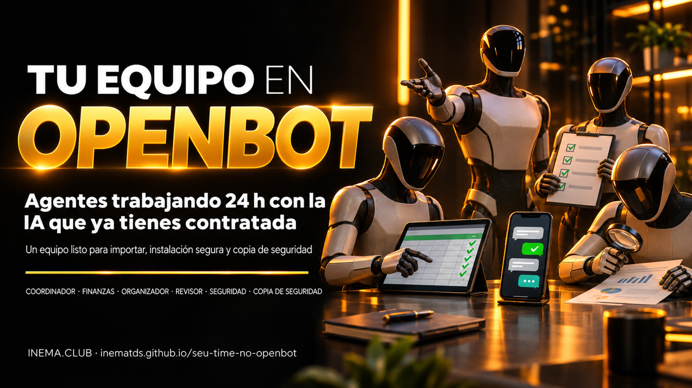

# 🤝 Tu equipo en OpenBot

**🇧🇷 [Português](README.md) · 🇺🇸 [English](README.en.md) · 🇪🇸 [Español](README.es.md)**

[](https://inematds.github.io/seu-time-no-openbot/guia/es/)

**Puedes tener tu propio equipo de agentes trabajando las 24 horas con la IA que ya tienes por suscripción.**
OpenBot pone ese equipo en tu computadora o en un VPS. Este kit incluye el equipo listo en
portugués (un coordinador, un asesor financiero, un organizador y un revisor), la instalación
segura con copia de seguridad y la lista de verificación de lo que debes cambiar antes de dejar
que los agentes trabajen solos.

## 📖 Guía

Para entender qué hace el kit y cómo puede cambiar tu día (sin aspectos técnicos):
**https://inematds.github.io/seu-time-no-openbot/guia/es/**

## Qué es

Es un kit gratuito para quienes quieren usar OpenBot, un programa que ejecuta agentes de IA en su
computadora o en un servidor, con la suscripción que ya tienen (ChatGPT/Codex, Claude, Gemini)
o con modelos gratuitos. El kit incluye cuatro agentes listos en portugués, un paquete para
importarlos todos de una vez, la instalación en Docker con protecciones y copia de seguridad,
una lista de verificación de seguridad y el tema de colores de INEMA. Necesitas tener OpenBot
instalado (en una computadora o en un VPS) y una cuenta de IA.

## Cómo empezar (sin conocimientos técnicos)

Abre la IA que ya usas (ChatGPT, Claude o Gemini, con la búsqueda en internet activada, o Claude Code / Codex, si ya los usas) en una conversación nueva y pega esta solicitud:

```text
Lee el kit https://github.com/inematds/seu-time-no-openbot (README.md, SEGURANCA.md e
instalacao/VPS.md). Explícame en lenguaje sencillo si OpenBot sirve para lo que hago, qué hace
cada agente del equipo, qué necesito tener (computadora o VPS, cuenta de IA, número de WhatsApp
separado) y qué cambia en mi seguridad. Después dime por dónde empezaría, en un máximo de 5 pasos.
No instales nada, no ejecutes docker ni cambies nada antes de que te dé el visto bueno.
```

## Qué incluye el kit

Las skills y los agentes del kit están escritos en portugués; pídele a tu agente que responda en tu idioma.

| Parte | Qué hace | Estado |
|---|---|---|
| `skills/` | 4 skills en portugués en el formato de OpenBot: Orquestador del equipo, Asesor financiero (con `resumo_semana.py`), Organizador personal, Revisor de entregas | validado por formato |
| `importar/` | `agentes.json` + `montar_pacote.py`: crea `dist/seu-time-openbot.zip` con los 4 agentes, las instrucciones, las skills, 3 rutinas (desactivadas) y el canal "Meu time" | validado por formato |
| `instalacao/compose.yaml` | Docker con seccomp oficial, `no-new-privileges`, límite de 6 GB, versión fija y volumen propio, sin puertos publicados | **probado en el VPS el 24/11/2026** (inicio y `status`) |
| `instalacao/backup.sh`, `restaurar.sh` | copia de seguridad del volumen completo con rotación, verificación y restauración | validado por formato + prueba con una carpeta ficticia |
| `instalacao/VPS.md` | OpenBot en un VPS, desde cero, comando por comando | pasos 1–5 probados en el VPS el 24/11; el resto, validado por formato |
| `instalacao/servidor-sem-docker.md` | la opción oficial sin Docker | validado por formato |
| `SEGURANCA.md` | lista de verificación: permisos, cuenta de IA, WhatsApp, bóveda de contraseñas, copia de seguridad, licencia | verificado en la documentación |
| `themes/inema.json` | tema INEMA (negro `#0c0c10`, amarillo `#FACC15`) | validado por formato |
| `validar.py` + `tests/` | verifica todo esto según las reglas de OpenBot v0.77.0 | ejecutado (resultado abajo) |

**"Validado por formato"** significa que el archivo sigue las reglas escritas en el código y la
documentación de OpenBot, y que `validar.py` lo verifica. **No significa** que se haya ejecutado
en OpenBot. Lo que sí se ejecutó está marcado como probado.

## ⚠️ Antes de usar

- Los agentes de OpenBot se ejecutan con acceso completo de forma predeterminada. Lee [SEGURANCA.md](SEGURANCA.md) (en portugués)
  y cambia a *Ask first* (preguntar antes) donde corresponda.
- WhatsApp: usa un **chip separado**. OpenBot usa un cliente no oficial y WhatsApp podría
  bloquear el número.
- OpenBot es gratuito para uso personal y no comercial (PolyForm Noncommercial 1.0.0). **El uso
  comercial requiere una licencia paga de OpenBot.** Consulta [FONTE.md](FONTE.md) (en portugués).

---

## Instalación técnica

_Los archivos detallados (SEGURANCA.md, instalacao/VPS.md, FONTE.md) están en portugués._

### Requisitos previos

- Para verificar el kit: Python 3.10+ con `pyyaml` y `pytest` (`pip install pyyaml pytest`), `bash`, `tar`.
- Para ejecutar OpenBot: la aplicación (macOS, Windows, Linux) de las [releases de OpenBot](https://github.com/nightly-labs/openbot/releases),
  o un VPS con Ubuntu 24.04, Docker y Compose ([instalacao/VPS.md](instalacao/VPS.md) (en portugués)).

### Archivos

```
skills/<nome>/SKILL.md          frontmatter name/description/example-prompt + instruções
importar/agentes.json           fonte do pacote (agentes, rotinas, memórias, canal)
importar/montar_pacote.py       gera dist/seu-time-openbot.zip (openbot-agent-import v1)
instalacao/compose.yaml         Docker (derivado do oficial, PolyForm Noncommercial)
instalacao/seccomp.sha256       hash do seccomp.json oficial da tag v0.77.0
instalacao/backup.sh            backup do /data com rotação
instalacao/restaurar.sh         restauração (faz backup do estado atual antes)
instalacao/achar-openbot.sh     acha o container e o volume (usado pelos dois acima)
themes/inema.json               tema no formato "Theme palette files"
validar.py                      confere skills, tema, pacote, compose e scripts
tests/test_kit.py               50 testes, sem docker
```

### Verificar el kit

```bash
python3 validar.py
python3 -m pytest -q
```

Resultado real del 24/11/2026:

```
OK    skills (4) no formato do openbot-skill-creator
OK    tema (inema.json) no formato Theme palette files
OK    manifesto de importação (openbot-agent-import v1)
OK    pacote seu-time-openbot.zip (zip montado)
OK    instalacao/compose.yaml (seccomp, no-new-privileges, memória, volume)
OK    backup.sh e restaurar.sh (bash -n)

Resultado: tudo certo · validado por formato, não testado num OpenBot em execução
50 passed
```

Las pruebas cubren: cada límite de las skills (name 80, description 500, example-prompt 1.000,
200 archivos, `.env`, zip dentro, enlace simbólico, ícono PNG, nombre con acento que se convierte
en un slug extraño), el tema (color faltante, hex incorrecto, apariencia, nombre del archivo),
el compose (sin seccomp, sin `no-new-privileges`, sin memoria, `latest`, carpeta del host, socket
de Docker, `unconfined` y coincidencia con el del VPS de prueba), el paquete (key, key repetida,
instrucciones de más de 2.000, agenda inválida, intervalo menor a 3 min, skill fuera de la carpeta
del agente, miembro desconocido, zona horaria inválida, manifiesto fuera de la raíz), la copia de
seguridad con una carpeta ficticia en lugar del volumen (ida y vuelta, permisos 600/700, rotación,
rechazo sin llavero sin borrar los antiguos, rechazo dentro de los datos, archivo dañado) y el
resumen semanal. Ninguna prueba ejecuta docker: un `docker` falso en el PATH hace que la prueba
falle si se lo llama.

### Crear el paquete del equipo

```bash
python3 importar/montar_pacote.py
# Pacote pronto: .../dist/seu-time-openbot.zip
```

En OpenBot: **Server settings → Import**, elige el `.zip`, marca los agentes e impórtalos
(`README.md` de OpenBot, "Import agents from Grok Bot"; el formato es el de
`resources/agent-import/grok-bot/SKILL.md`). Las rutinas llegan **desactivadas**. Sin importar,
puedes crear las skills una por una: pídele a un agente que registre la carpeta `skills/<nome>`
como skill local (`create_skill`, consulta `openbot-skill-creator`).

### Tema INEMA

En la aplicación de escritorio, en Linux (en macOS y Windows, la carpeta `themes` está dentro de
la carpeta de datos de OpenBot):

```bash
mkdir -p ~/.config/OpenBot/themes
cp themes/inema.json ~/.config/OpenBot/themes/.inema.json.tmp
mv ~/.config/OpenBot/themes/.inema.json.tmp ~/.config/OpenBot/themes/inema.json
```

`mv` reemplaza el archivo de una sola vez, como pide el README de OpenBot. Después: Settings > Appearance > Theme.

### En el VPS

Paso a paso completo en [instalacao/VPS.md](instalacao/VPS.md) (en portugués). Resumen:

```bash
sudo mkdir -p /opt/openbot && cd /opt/openbot
# copie para cá: compose.yaml, seccomp.sha256, backup.sh, restaurar.sh, achar-openbot.sh
sudo curl -fsSLO https://raw.githubusercontent.com/nightly-labs/openbot/v0.77.0/docker/seccomp.json
sudo sha256sum -c seccomp.sha256
sudo docker compose pull && sudo docker compose up -d       # testado na VPS em 24/11/2026
sudo docker compose exec -T openbot openbot status          # testado na VPS em 24/11/2026
sudo docker compose exec openbot openbot login               # validado por formato
sudo bash backup.sh                                          # validado por formato
```

## El proceso, de principio a fin

🧠 = sesión con Nei (o contigo, en tu computadora) · ⚙️ = script/timer · 🤖 = `claude -p` corto (sesión nueva)

| # | Paso | Comando / qué sucede | Quién | Estado |
|---|---|---|---|---|
| 1 | Leer la lista | [SEGURANCA.md](SEGURANCA.md) (en portugués): permisos, cuenta, WhatsApp, bóveda, licencia | 🧠 | — |
| 2 | Verificar el kit | `python3 validar.py && python3 -m pytest -q` | ⚙️ | ejecutado el 24/11 |
| 3 | Crear el paquete | `python3 importar/montar_pacote.py` → `dist/seu-time-openbot.zip` | ⚙️ | validado por formato |
| 4 | Iniciar OpenBot en el VPS | pasos 1–5 de `instalacao/VPS.md` (`docker compose pull && docker compose up -d`, `openbot status`) | ⚙️ | probado en el VPS el 24/11 |
| 5 | Iniciar sesión en OpenBot | `docker compose exec openbot openbot login` (correo + código) | 🧠 | validado por formato |
| 6 | Conectar la IA | en la aplicación o en `openbot.run/app`: Codex, Claude, Gemini u OpenCode (Free) | 🧠 | validado por formato |
| 7 | Importar el equipo | Server settings → Import → `seu-time-openbot.zip` | 🧠 | validado por formato |
| 7b | Activar WhatsApp (opcional) | chip separado; Marketplace → Apps → WhatsApp → *A number only for OpenBot*. El propio *WhatsApp Orchestrator* de OpenBot responde y debería pasar los gastos a Finanzas ([VPS.md](instalacao/VPS.md) (en portugués), paso 10) | 🧠 | no probado |
| 8 | Reducir los permisos | configura cada agente en *Ask first* (SEGURANCA.md §1) | 🧠 | validado por formato |
| 9 | Tema | copiar `themes/inema.json` a la carpeta `themes` (arriba) | ⚙️ | validado por formato |
| 10 | Activar las rutinas | una por vez: Plan del día, Resumen de la semana, Revisión de la semana | 🧠 | validado por formato |
| 11 | Copia de seguridad diaria | `crontab`: `0 4 * * * cd /opt/openbot && bash backup.sh` + copia fuera del VPS | ⚙️ | validado por formato |
| 12 | Revisar la guía | revisor independiente (`claude -p`, runbook `revisor-independente.md`) lee la guía publicada | 🤖 | hecho el 24/11 |
| 13 | Nueva versión de OpenBot | cambiar la etiqueta en FONTE.md, `compose.yaml`, `seccomp.sha256` y las referencias de `validar.py`; ejecutar el paso 2 | 🧠 + ⚙️ | — |

## La prueba

Lo que sí se ejecutó: `validar.py` y las 50 pruebas de este repositorio (resultado arriba) y, en
un VPS de prueba de INEMA el 24/11/2026, el inicio del contenedor con este `compose.yaml` y el
comando `openbot status` (`OpenBot 0.77.0 · Memory: 5428 MiB free of 6144 MiB (ok) · Turns at the same time: at most 8`).
Lo que **todavía no** se ejecutó: inicio de sesión, proveedor, WhatsApp, importación del paquete,
las skills dentro de un agente, el tema en la aplicación y la copia de seguridad del volumen real.

## De dónde viene

OpenBot v0.77.0 (`nightly-labs/openbot`, commit `20d1cd6`). Todo lo que afirma el kit sobre
OpenBot proviene de la documentación y el código de esa versión, enumerados en [FONTE.md](FONTE.md) (en portugués), junto con la licencia y los avisos obligatorios. Este kit no es oficial y no incluye el código de OpenBot.

## Licencia

Archivos del kit: MIT ([LICENSE](LICENSE)). `instalacao/compose.yaml` deriva de OpenBot y sigue
PolyForm Noncommercial 1.0.0. OpenBot en sí: PolyForm Noncommercial 1.0.0; el uso comercial
requiere una licencia paga.

---

Hecho por [INEMA.CLUB](https://inema.club): contenido abierto y gratuito sobre IA en la práctica.